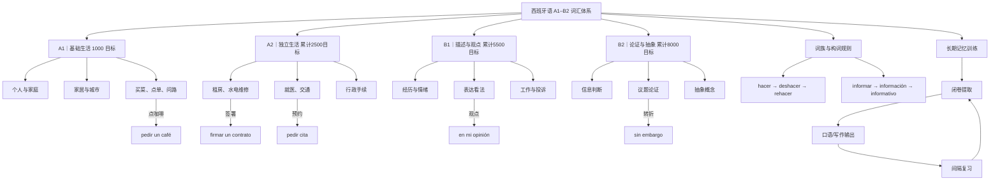

# A1–B2｜词汇知识地图（可交互渲染的 Mermaid）

> 此图是 **导航概念图**：主题层 → 高频词块 → 关联词族 → 主动回忆。点击 Markdown 文件内的 Mermaid 图，可在支持 Mermaid 的界面阅读。主仓库词汇候选库是 8,000 个待审的词元，不代表全部已完成释义/例句。

## 导航

- [A1 基础语义图](A1-生活核心语义图.md)
- [A2 西班牙生活事务图](A2-租房交通与行政.md)
- [B1 观点与经历图](B1-表达观点与经历.md)
- [B2 深度论证图](B2-论证与抽象语义.md)
- [构词与词族关系图](词族-词根词缀关系图.md)
- [训练规则](../docs/记忆系统-学习协议.md)

注意：概念图并非考试；须在不看图时恢复节点并造句，才能有效练习提取。
