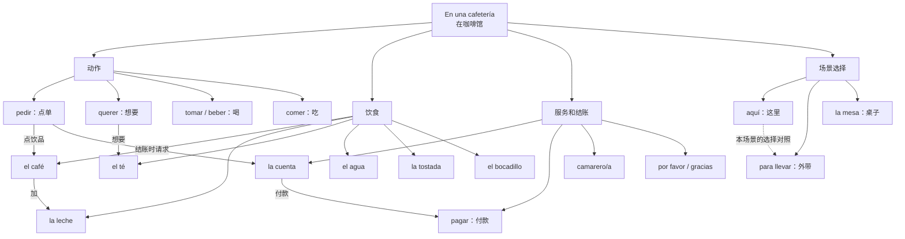

# A1｜咖啡馆点单词汇语义网络

> 阅读方法：先看完整图 → 合上屏幕，从主题回忆至少 10 个词/词块 → 用记得的内容说一段点单对话 → 核对遗漏。

## 按用途重构，不按拼写背诵

- **点东西**：`pedir un café` / `Quiero un té.`
- **修饰饮品**：`con leche` / `sin azúcar`
- **堂食/外带**：`para tomar aquí` / `para llevar`
- **结账**：`pedir la cuenta` / `pagar`
- **礼貌交际**：`por favor` / `gracias`

## 离开这张图的测试

1. 只看“动作/饮食/结账/选择”四个中文分类，分别回忆西班牙语。
2. 把三个核心关系连成一句完整的自然表达。
3. 口头演练：`Un té sin azúcar para llevar, por favor.`
4. 自己重画图，发现遗漏后单独加入复习记录。
