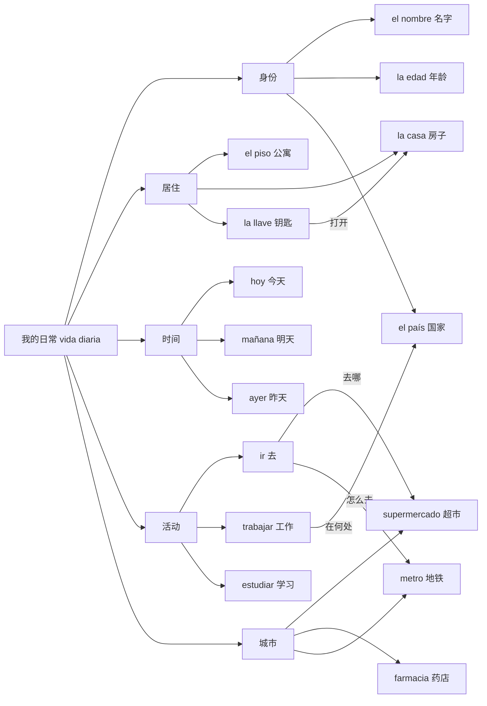

# A1｜基础生活高频语义图

### 闭卷输出

1. 介绍你的名字、居住城市和正在学习的语言。
2. 说你今天做什么、明天去哪儿。
3. 问别人“地铁/药店在哪里？”。

### 词块

- `Vivo en Madrid.` 我住在马德里。
- `Estudio español.` 我学习西语。
- `¿Dónde está la farmacia?` 药店在哪里？
- `Voy al supermercado.` 我去超市。
