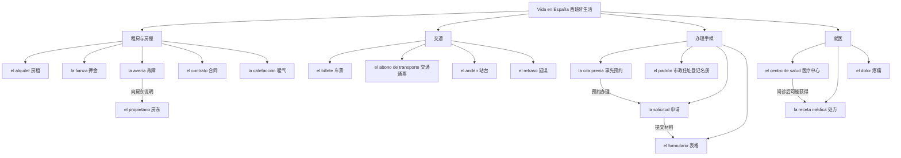

# A2｜西班牙生活事务：租房、交通、行政

## 说明

- `empadronarse` 是办理住址登记。上图的 `el padrón` 是相关名词，属于实际西班牙生活高频词。
- 公共管理手续的要求可能随自治区域和办理事项而变化；图仅用于学习词汇，不作为最新行政指南。

## 无提示练习

- 用 `alquiler / fianza / contrato` 问房东三个问题。
- 表达“我的暖气坏了，需要修理”。
- 表达“我需要预约办理这项手续”。
- 区分 `billete`（单张车票）与 `abono de transporte`（交通通票，具体产品按地区不同）。
