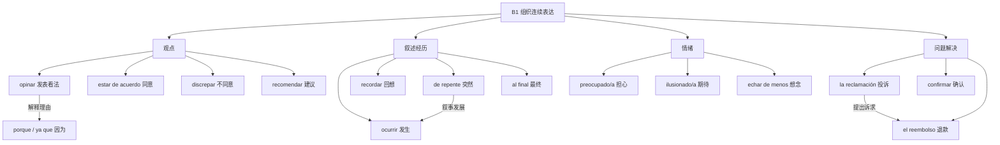

# B1｜论述观点、事件和人际关系

### 真实产出任务

1. 说出对“是否应该拥有汽车”的观点和两个原因。
2. 讲一次办手续/旅行中遇到的突发情况：背景 → 事件 → 结果。
3. 模拟向客服提出投诉，确认退款方式。

### 句块样例

- `En mi opinión, el transporte público es más cómodo.` 我认为公共交通更方便。
- `Ayer ocurrió algo inesperado.` 昨天发生了意外的事。
- `Quiero presentar una reclamación.` 我想提出投诉。
