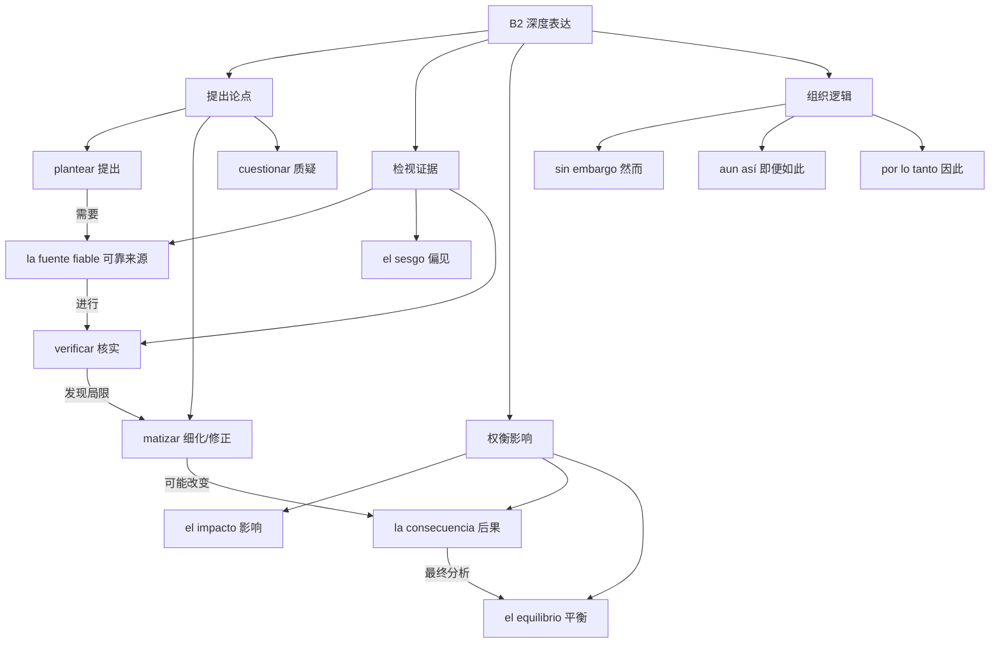

# B2｜论证、信息核实与抽象表达

### 练习：住房议题（示范）

- `El acceso a la vivienda es un problema complejo.` 获得住房的难度是一个复杂问题。
- `Sin embargo, conviene analizar varias causas.` 然而，应当分析多种原因。
- `Por lo tanto, cualquier medida debería evaluarse con datos.` 因此，应当用数据评估任何措施。

**闭卷任务**：用 5 句表达“城市住房”问题，必须包含“观点 → 依据 → 让步/限制 → 结果”，不能逐句抄模板。
