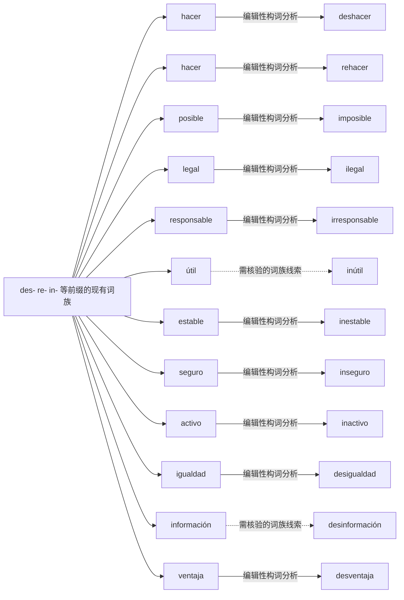

# des- re- in- 等前缀的现有词族｜可编辑 Mermaid 词族图

> 这是**现代词形与词族学习关系图**，不是逐条获权威词源词典确认的历史关系图。实线表示相对透明的编辑性构词分析；虚线表示存在词干交替、历史关系或词汇化的词族线索。图中词与关系都可以直接在 Markdown 中修改。所有词必须在具体用法中核实。

## 逐词分解与核对提示（12 条）

| 词项 | 表层结构 / 词素线索 | 中文语义 | 分析备注 |
|---|---|---|---|
| **deshacer** | des · hacer | 补充词族例词（主词库未收录） | 现代前缀派生；原词与派生词必须分别掌握；des- 可表达撤销既有动作；并非任意动词都能这样派生。 |
| **rehacer** | re · hacer | 补充词族例词（主词库未收录） | 现代前缀派生；原词与派生词必须分别掌握；表示再次做或重新制作。 |
| **imposible** | im · posible | 补充词族例词（主词库未收录） | 现代前缀派生；原词与派生词必须分别掌握；in- 在 p 前常表现为 im-。 |
| **ilegal** | i · legal | 补充词族例词（主词库未收录） | 现代前缀派生；原词与派生词必须分别掌握；这是 in- 的否定变体，书写只保留一个 l。 |
| **irresponsable** | ir · responsable | 补充词族例词（主词库未收录） | 现代前缀派生；原词与派生词必须分别掌握；in- 在 r 前同化为 ir-。 |
| **inútil** | in · útil | 补充词族例词（主词库未收录） | 现代前缀派生；原词与派生词必须分别掌握；常见否定派生，前缀不能照搬所有词。 |
| **inestable** | in · estable | 补充词族例词（主词库未收录） | 现代前缀派生；原词与派生词必须分别掌握；对比 estable 和 inestable。 |
| **inseguro** | in · seguro | 补充词族例词（主词库未收录） | 现代前缀派生；原词与派生词必须分别掌握；不安全、不确定，具体意义由语境决定。 |
| **inactivo** | in · activo | 补充词族例词（主词库未收录） | 现代前缀派生；原词与派生词必须分别掌握；表示未启用/不活跃。 |
| **desigualdad** | des · igualdad | 不平等 | 现代前缀派生；原词与派生词必须分别掌握；在抽象名词上表示否定/不平等，可进一步分析 igualdad。 |
| **desinformación** | des · información | 虚假或误导性信息的传播 | 现代前缀派生；原词与派生词必须分别掌握；前缀派生与信息传播语义有关，注意词汇化。 |
| **desventaja** | des · ventaja | 缺点；不利之处 | 现代前缀派生；原词与派生词必须分别掌握；是成熟的词条；不意味着任意名词可加 des-。 |

[返回构词系统总目录](README-完整词根词缀系统.md) · [完整结构化校验数据](../data/morphology/curated_analyses.csv) · [逐条索引](../data/morphology/morphology_master.csv)
