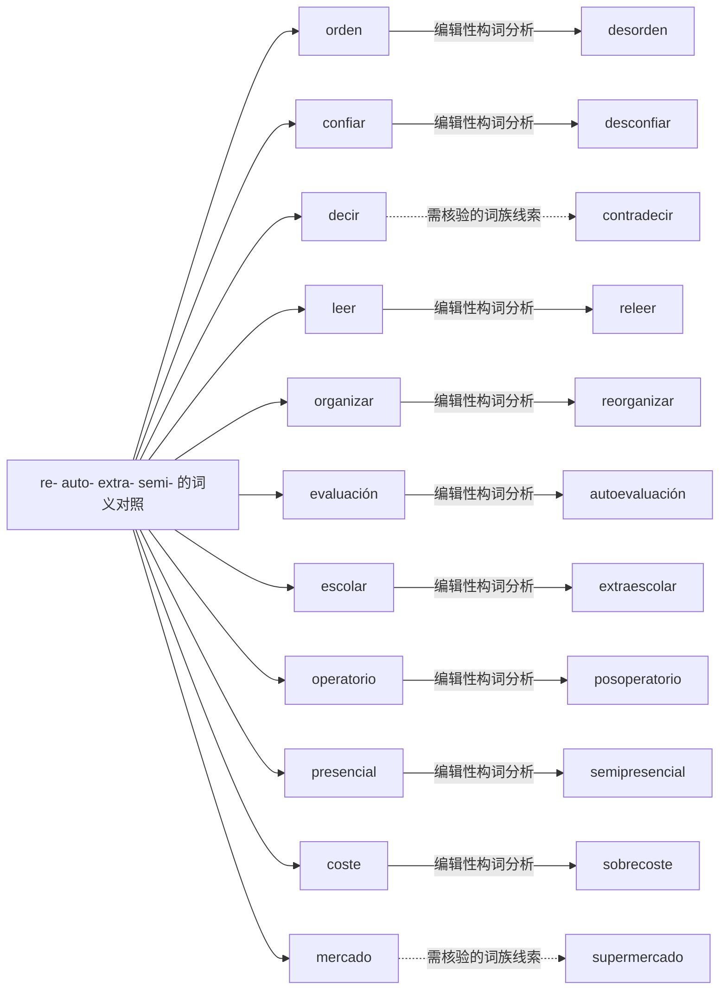

# re- auto- extra- semi- 的词义对照｜可编辑 Mermaid 词族图

> 这是**现代词形与词族学习关系图**，不是逐条获权威词源词典确认的历史关系图。实线表示相对透明的编辑性构词分析；虚线表示存在词干交替、历史关系或词汇化的词族线索。图中词与关系都可以直接在 Markdown 中修改。所有词必须在具体用法中核实。

## 逐词分解与核对提示（11 条）

| 词项 | 表层结构 / 词素线索 | 中文语义 | 分析备注 |
|---|---|---|---|
| **desorden** | des · orden | 补充词族例词（主词库未收录） | 现代前缀派生；原词与派生词必须分别掌握；表示缺乏秩序，注意 des- 词义有差异。 |
| **desconfiar** | des · confiar | 补充词族例词（主词库未收录） | 现代前缀派生；原词与派生词必须分别掌握；表示不信任，实际搭配常见 desconfiar de。 |
| **contradecir** | contra · decir | 反驳；与……矛盾 | 现代前缀派生；原词与派生词必须分别掌握；对着说、反驳；原形 decir 不规则。 |
| **releer** | re · leer | 补充词族例词（主词库未收录） | 现代前缀派生；原词与派生词必须分别掌握；重读，-ee- 保留。 |
| **reorganizar** | re · organizar | 补充词族例词（主词库未收录） | 现代前缀派生；原词与派生词必须分别掌握；重新组织；区别组织名词 organización。 |
| **autoevaluación** | auto · evaluación | 补充词族例词（主词库未收录） | 现代前缀派生；原词与派生词必须分别掌握；自我评估；勿把 auto- 和汽车 auto 混为一谈。 |
| **extraescolar** | extra · escolar | 补充词族例词（主词库未收录） | 现代前缀派生；原词与派生词必须分别掌握；课外的；extra- 指范围之外。 |
| **posoperatorio** | pos · operatorio | 补充词族例词（主词库未收录） | 现代前缀派生；原词与派生词必须分别掌握；术后，按医疗机构语境理解。 |
| **semipresencial** | semi · presencial | 补充词族例词（主词库未收录） | 现代前缀派生；原词与派生词必须分别掌握；部分线下的，课程/行政常用。 |
| **sobrecoste** | sobre · coste | 补充词族例词（主词库未收录） | 现代前缀派生；原词与派生词必须分别掌握；超出预计成本，常用于合同。 |
| **supermercado** | super · mercado | 超市 | 现代前缀派生；原词与派生词必须分别掌握；此词已固定词汇化；不能凭 super- 推断所有意义。 |

[返回构词系统总目录](README-完整词根词缀系统.md) · [完整结构化校验数据](../data/morphology/curated_analyses.csv) · [逐条索引](../data/morphology/morphology_master.csv)
