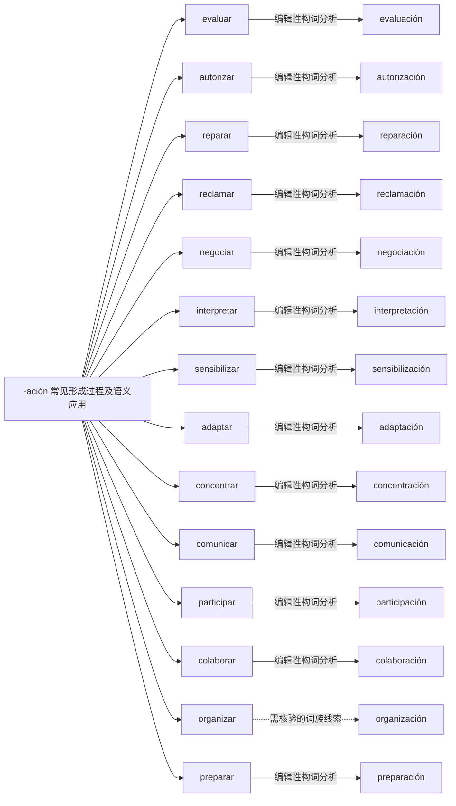

# -ación 常见形成过程及语义应用｜可编辑 Mermaid 词族图

> 这是**现代词形与词族学习关系图**，不是逐条获权威词源词典确认的历史关系图。实线表示相对透明的编辑性构词分析；虚线表示存在词干交替、历史关系或词汇化的词族线索。图中词与关系都可以直接在 Markdown 中修改。所有词必须在具体用法中核实。

## 逐词分解与核对提示（14 条）

| 词项 | 表层结构 / 词素线索 | 中文语义 | 分析备注 |
|---|---|---|---|
| **evaluación** | evalu · ación | 评估；评价 | 动词或形容词相关的名词化，关注词干和后缀交替；由 evaluar 相关名词；主题元音和后缀常合并教学为 -ación。 |
| **autorización** | autoriz · ación | 授权；同意书 | 动词或形容词相关的名词化，关注词干和后缀交替；办事中指授权，词基 autoriz-。 |
| **reparación** | repar · ación | 修理 | 动词或形容词相关的名词化，关注词干和后缀交替；由 reparar 形成动作/结果名词。 |
| **reclamación** | reclam · ación | 投诉；索赔 | 动词或形容词相关的名词化，关注词干和后缀交替；正式投诉或索赔，不等同口头不满。 |
| **negociación** | negoci · ación | 谈判；协商 | 动词或形容词相关的名词化，关注词干和后缀交替；由 negociar 形成过程名词。 |
| **interpretación** | interpret · ación | 解释；理解 | 动词或形容词相关的名词化，关注词干和后缀交替；理解/解释，不只是翻译。 |
| **sensibilización** | sensibiliz · ación | 意识提升；宣传教育 | 动词或形容词相关的名词化，关注词干和后缀交替；由 sensibilizar 形成意识提升类名词。 |
| **adaptación** | adapt · ación | 适应；调整 | 动词或形容词相关的名词化，关注词干和后缀交替；适应过程或成果。 |
| **concentración** | concentr · ación | 专注力 | 动词或形容词相关的名词化，关注词干和后缀交替；专注度/集中，也可具体指浓度。 |
| **comunicación** | comunic · ación | 沟通 | 动词或形容词相关的名词化，关注词干和后缀交替；沟通过程，区别 comunicar 动作。 |
| **participación** | particip · ación | 参与 | 动词或形容词相关的名词化，关注词干和后缀交替；参与；学校语境高频。 |
| **colaboración** | colabor · ación | 合作 | 动词或形容词相关的名词化，关注词干和后缀交替；合作；动词 colaborar con。 |
| **organización** | organiz · ación | 补充词族例词（主词库未收录） | 动词或形容词相关的名词化，关注词干和后缀交替；组织活动/机构，不能把词干机械还原为 organiza。 |
| **preparación** | prepar · ación | 补充词族例词（主词库未收录） | 动词或形容词相关的名词化，关注词干和后缀交替；准备。 |

[返回构词系统总目录](README-完整词根词缀系统.md) · [完整结构化校验数据](../data/morphology/curated_analyses.csv) · [逐条索引](../data/morphology/morphology_master.csv)
