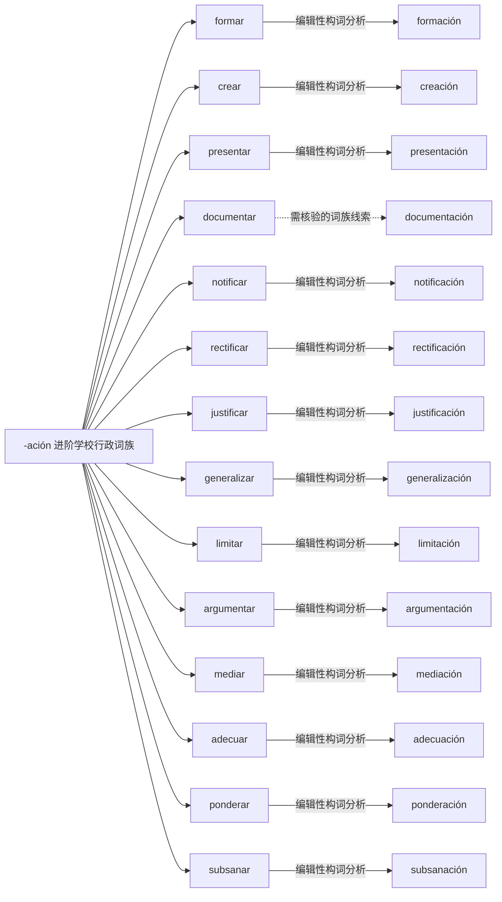

# -ación 进阶学校行政词族｜可编辑 Mermaid 词族图

> 这是**现代词形与词族学习关系图**，不是逐条获权威词源词典确认的历史关系图。实线表示相对透明的编辑性构词分析；虚线表示存在词干交替、历史关系或词汇化的词族线索。图中词与关系都可以直接在 Markdown 中修改。所有词必须在具体用法中核实。

## 逐词分解与核对提示（14 条）

| 词项 | 表层结构 / 词素线索 | 中文语义 | 分析备注 |
|---|---|---|---|
| **formación** | form · ación | 培训；教育背景 | 动词或形容词相关的名词化，关注词干和后缀交替；培养/培训；同词多义。 |
| **creación** | cre · ación | 补充词族例词（主词库未收录） | 动词或形容词相关的名词化，关注词干和后缀交替；拼写形成 cre- + -ación；和创建过程关联。 |
| **presentación** | present · ación | 补充词族例词（主词库未收录） | 动词或形容词相关的名词化，关注词干和后缀交替；展示/报告；不等于直接“现在”。 |
| **documentación** | document · ación | 材料／文件 | 动词或形容词相关的名词化，关注词干和后缀交替；证明资料/文件汇总；词义已词汇化。 |
| **notificación** | notific · ación | 送达通知 | 动词或形容词相关的名词化，关注词干和后缀交替；通知送达，行政常用。 |
| **rectificación** | rectific · ación | 更正；纠正 | 动词或形容词相关的名词化，关注词干和后缀交替；更正、纠正。 |
| **justificación** | justific · ación | 理由；论证依据 | 动词或形容词相关的名词化，关注词干和后缀交替；证明或说明理由。 |
| **generalización** | generaliz · ación | 概括；以偏概全 | 动词或形容词相关的名词化，关注词干和后缀交替；概括；注意滥用概括。 |
| **limitación** | limit · ación | 限制；局限 | 动词或形容词相关的名词化，关注词干和后缀交替；限制/局限。 |
| **argumentación** | argument · ación | 论证 | 动词或形容词相关的名词化，关注词干和后缀交替；论证结构。 |
| **mediación** | medi · ación | 调解；协调 | 动词或形容词相关的名词化，关注词干和后缀交替；调解；词义和 mediar 的搭配关联。 |
| **adecuación** | adecu · ación | 适当性；符合程度 | 动词或形容词相关的名词化，关注词干和后缀交替；适当性、符合程度。 |
| **ponderación** | ponder · ación | 权重；加权 | 动词或形容词相关的名词化，关注词干和后缀交替；加权、权衡。 |
| **subsanación** | subsan · ación | 补正；纠正材料 | 动词或形容词相关的名词化，关注词干和后缀交替；补正、纠错，行政术语。 |

[返回构词系统总目录](README-完整词根词缀系统.md) · [完整结构化校验数据](../data/morphology/curated_analyses.csv) · [逐条索引](../data/morphology/morphology_master.csv)
