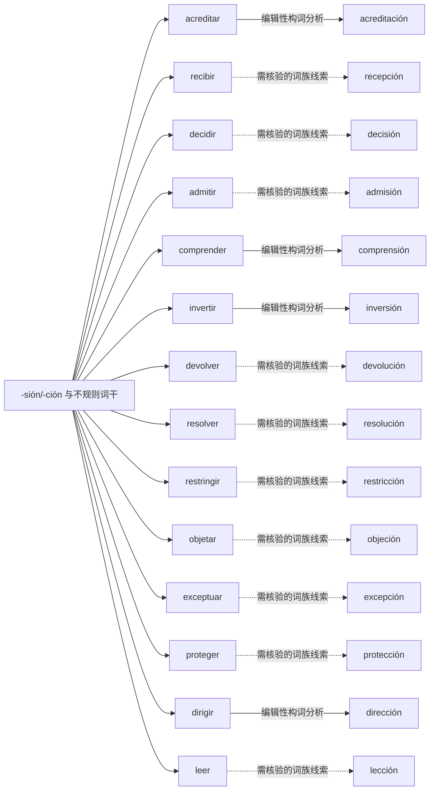

# -sión/-ción 与不规则词干｜可编辑 Mermaid 词族图

> 这是**现代词形与词族学习关系图**，不是逐条获权威词源词典确认的历史关系图。实线表示相对透明的编辑性构词分析；虚线表示存在词干交替、历史关系或词汇化的词族线索。图中词与关系都可以直接在 Markdown 中修改。所有词必须在具体用法中核实。

## 逐词分解与核对提示（14 条）

| 词项 | 表层结构 / 词素线索 | 中文语义 | 分析备注 |
|---|---|---|---|
| **acreditación** | acredit · ación | 证明；认证 | 动词或形容词相关的名词化，关注词干和后缀交替；资格或事实的证明。 |
| **recepción** | recep · ción | 接待台 | 动词或形容词相关的名词化，关注词干和后缀交替；书面形式来自拉丁词干，**不是**现代 recibir + -ción 的直接拼接。 |
| **decisión** | deci · sión | 决定 | 动词或形容词相关的名词化，关注词干和后缀交替；历史词干变化，不能把 decidir 直接去尾加 -sión。 |
| **admisión** | admi · sión | 入学申请；录取 | 动词或形容词相关的名词化，关注词干和后缀交替；形式存在词干交替，作为词族记忆，不是可自由套用公式。 |
| **comprensión** | compren · sión | 补充词族例词（主词库未收录） | 动词或形容词相关的名词化，关注词干和后缀交替；现代词尾无法简单从 comprender 推出，按既有词形记。 |
| **inversión** | inver · sión | 投资 | 动词或形容词相关的名词化，关注词干和后缀交替；词干与词义存在变化，切勿按规则自动造词。 |
| **devolución** | devolu · ción | 退货；退还 | 动词或形容词相关的名词化，关注词干和后缀交替；词干交替，建议作为不规则构词记忆。 |
| **resolución** | resolu · ción | 行政决定 | 动词或形容词相关的名词化，关注词干和后缀交替；现代词干与 resolver 不完全相同，需整体记忆。 |
| **restricción** | restric · ción | 限制 | 动词或形容词相关的名词化，关注词干和后缀交替；词干与动词不直接同形，结构标作历史词族线索。 |
| **objeción** | obje · ción | 异议 | 动词或形容词相关的名词化，关注词干和后缀交替；词形历史路径非简单现代派生；不能根据表面字母自行推出词源。 |
| **excepción** | excep · ción | 例外 | 动词或形容词相关的名词化，关注词干和后缀交替；历史词干有交替；现代词语关系需进一步词源核查。 |
| **protección** | protec · ción | 保护 | 动词或形容词相关的名词化，关注词干和后缀交替；历史/词干变体，不能把 proteger 截尾即得保护名词。 |
| **dirección** | direc · ción | 地址 | 动词或形容词相关的名词化，关注词干和后缀交替；关系主要经拉丁词根，非现代透明派生。 |
| **lección** | lec · ción | 一课；课程内容 | 动词或形容词相关的名词化，关注词干和后缀交替；词源上同拉丁读/选取词族有关，但不是现代 leer + -ción 的生产性派生。 |

[返回构词系统总目录](README-完整词根词缀系统.md) · [完整结构化校验数据](../data/morphology/curated_analyses.csv) · [逐条索引](../data/morphology/morphology_master.csv)
