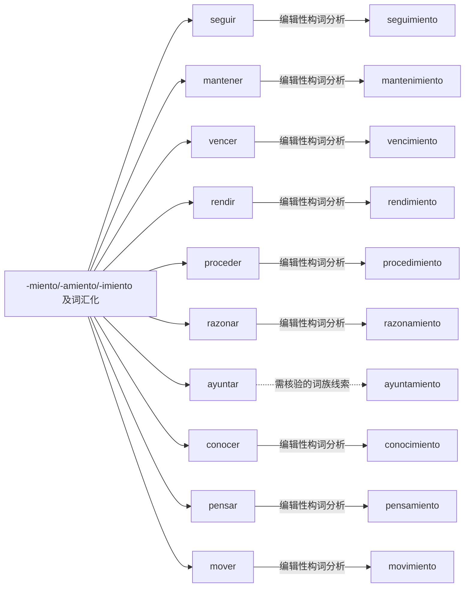

# -miento/-amiento/-imiento 及词汇化｜可编辑 Mermaid 词族图

> 这是**现代词形与词族学习关系图**，不是逐条获权威词源词典确认的历史关系图。实线表示相对透明的编辑性构词分析；虚线表示存在词干交替、历史关系或词汇化的词族线索。图中词与关系都可以直接在 Markdown 中修改。所有词必须在具体用法中核实。

## 逐词分解与核对提示（10 条）

| 词项 | 表层结构 / 词素线索 | 中文语义 | 分析备注 |
|---|---|---|---|
| **seguimiento** | segu · imiento | 跟进；追踪 | 名词化 -miento 的现有词形与不同词干形态；词干来自 seguir，追踪、继续的结果名词。 |
| **mantenimiento** | manten · imiento | 维护 | 名词化 -miento 的现有词形与不同词干形态；动词 mantener，注意拼写和词义。 |
| **vencimiento** | venc · imiento | 到期；届满 | 名词化 -miento 的现有词形与不同词干形态；到期；行政财经场景高频。 |
| **rendimiento** | rend · imiento | 表现；绩效 | 名词化 -miento 的现有词形与不同词干形态；产出、表现；并非简单的“做完”。 |
| **procedimiento** | proced · imiento | 程序；办理流程 | 名词化 -miento 的现有词形与不同词干形态；程序；-imiento 词义已制度化。 |
| **razonamiento** | razon · amiento | 推理；论证思路 | 名词化 -miento 的现有词形与不同词干形态；推理过程。 |
| **ayuntamiento** | ayunt · amiento | 市政府；市政厅 | 名词化 -miento 的现有词形与不同词干形态；市政府词义高度词汇化，不能按字面“联合行为”直接推出。 |
| **conocimiento** | conoc · imiento | 补充词族例词（主词库未收录） | 名词化 -miento 的现有词形与不同词干形态；词干形式与 conocer 保持关联，元音变化需单独练习。 |
| **pensamiento** | pens · amiento | 补充词族例词（主词库未收录） | 名词化 -miento 的现有词形与不同词干形态；思想/思维过程。 |
| **movimiento** | mov · imiento | 补充词族例词（主词库未收录） | 名词化 -miento 的现有词形与不同词干形态；运动、动作、变动。 |

[返回构词系统总目录](README-完整词根词缀系统.md) · [完整结构化校验数据](../data/morphology/curated_analyses.csv) · [逐条索引](../data/morphology/morphology_master.csv)
