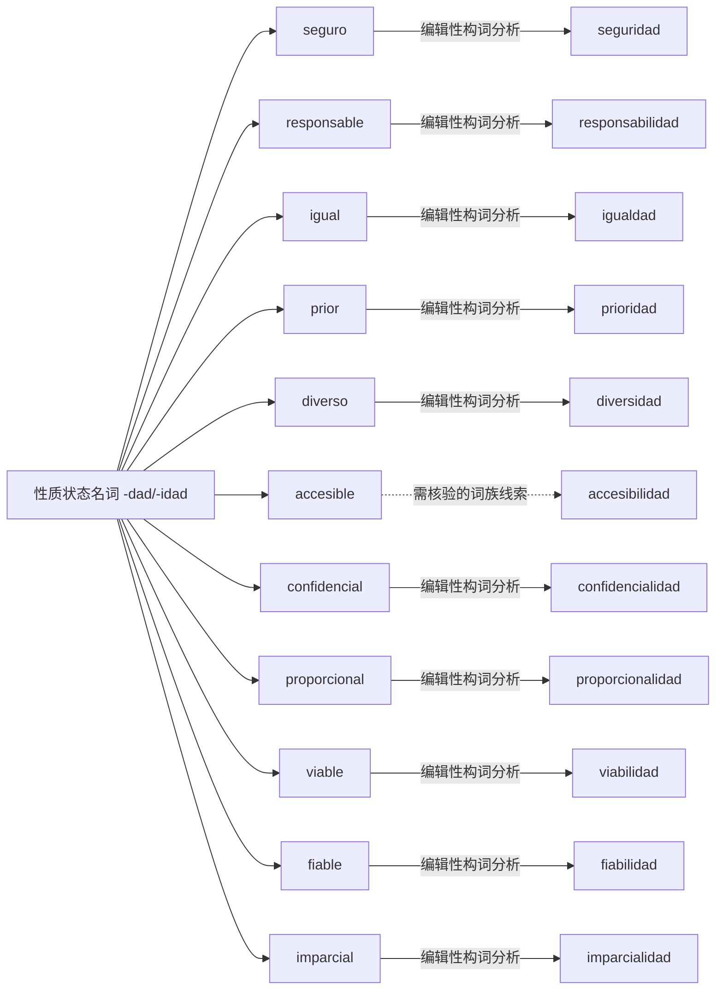

# 性质状态名词 -dad/-idad｜可编辑 Mermaid 词族图

> 这是**现代词形与词族学习关系图**，不是逐条获权威词源词典确认的历史关系图。实线表示相对透明的编辑性构词分析；虚线表示存在词干交替、历史关系或词汇化的词族线索。图中词与关系都可以直接在 Markdown 中修改。所有词必须在具体用法中核实。

## 逐词分解与核对提示（11 条）

| 词项 | 表层结构 / 词素线索 | 中文语义 | 分析备注 |
|---|---|---|---|
| **seguridad** | segur · idad | 安全 | 形容词/状态衍生名词及词干变体；安全性、保障，去掉形容词性结尾 -o。 |
| **responsabilidad** | responsabil · idad | 责任 | 形容词/状态衍生名词及词干变体；基础词 responsable 的词干变化 -e → -i-。 |
| **igualdad** | igual · dad | 补充词族例词（主词库未收录） | 形容词/状态衍生名词及词干变体；平等；由形容词 igual 形成。 |
| **prioridad** | prior · idad | 优先事项 | 形容词/状态衍生名词及词干变体；优先级，prior 本身多在较正式语境出现。 |
| **diversidad** | divers · idad | 多样性 | 形容词/状态衍生名词及词干变体；多样性。 |
| **accesibilidad** | accesibil · idad | 无障碍；可及性 | 形容词/状态衍生名词及词干变体；基础词 accesible 与抽象名词词干交替。 |
| **confidencialidad** | confidencial · idad | 保密性 | 形容词/状态衍生名词及词干变体；保密性。 |
| **proporcionalidad** | proporcional · idad | 比例原则；相称性 | 形容词/状态衍生名词及词干变体；相称性；B2 行政正式语汇。 |
| **viabilidad** | viabil · idad | 可行性 | 形容词/状态衍生名词及词干变体；可行性；e/i 交替。 |
| **fiabilidad** | fiabil · idad | 可靠性 | 形容词/状态衍生名词及词干变体；可靠程度。 |
| **imparcialidad** | imparcial · idad | 公正性；不偏不倚 | 形容词/状态衍生名词及词干变体；公正性；可进一步分出否定 im-。 |

[返回构词系统总目录](README-完整词根词缀系统.md) · [完整结构化校验数据](../data/morphology/curated_analyses.csv) · [逐条索引](../data/morphology/morphology_master.csv)
