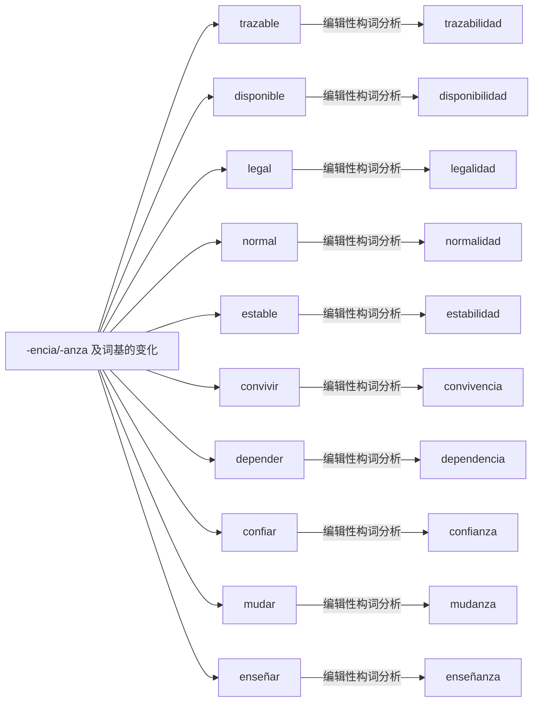

# -encia/-anza 及词基的变化｜可编辑 Mermaid 词族图

> 这是**现代词形与词族学习关系图**，不是逐条获权威词源词典确认的历史关系图。实线表示相对透明的编辑性构词分析；虚线表示存在词干交替、历史关系或词汇化的词族线索。图中词与关系都可以直接在 Markdown 中修改。所有词必须在具体用法中核实。

## 逐词分解与核对提示（10 条）

| 词项 | 表层结构 / 词素线索 | 中文语义 | 分析备注 |
|---|---|---|---|
| **trazabilidad** | trazabil · idad | 可追溯性 | 形容词/状态衍生名词及词干变体；可追溯性，主要技术和行政语境。 |
| **disponibilidad** | disponibil · idad | 补充词族例词（主词库未收录） | 形容词/状态衍生名词及词干变体；可用性，从形容词 disponible 关联而来。 |
| **legalidad** | legal · idad | 补充词族例词（主词库未收录） | 形容词/状态衍生名词及词干变体；合法性；与 legal 相连。 |
| **normalidad** | normal · idad | 补充词族例词（主词库未收录） | 形容词/状态衍生名词及词干变体；正常状态。 |
| **estabilidad** | estabil · idad | 补充词族例词（主词库未收录） | 形容词/状态衍生名词及词干变体；稳定性，表层的字母交替。 |
| **convivencia** | conviv · encia | 共同生活；和睦相处 | 形容词/状态衍生名词及词干变体；共同生活、和睦相处；非任意 -encia 都从动词得到。 |
| **dependencia** | depend · encia | 补充词族例词（主词库未收录） | 形容词/状态衍生名词及词干变体；依赖关系，也可指行政机构/扶助依赖程度。 |
| **confianza** | confi · anza | 信任；信心 | 形容词/状态衍生名词及词干变体；信任、信心。 |
| **mudanza** | mud · anza | 搬家 | 形容词/状态衍生名词及词干变体；搬迁/搬家。 |
| **enseñanza** | enseñ · anza | 补充词族例词（主词库未收录） | 形容词/状态衍生名词及词干变体；教学活动。 |

[返回构词系统总目录](README-完整词根词缀系统.md) · [完整结构化校验数据](../data/morphology/curated_analyses.csv) · [逐条索引](../data/morphology/morphology_master.csv)
