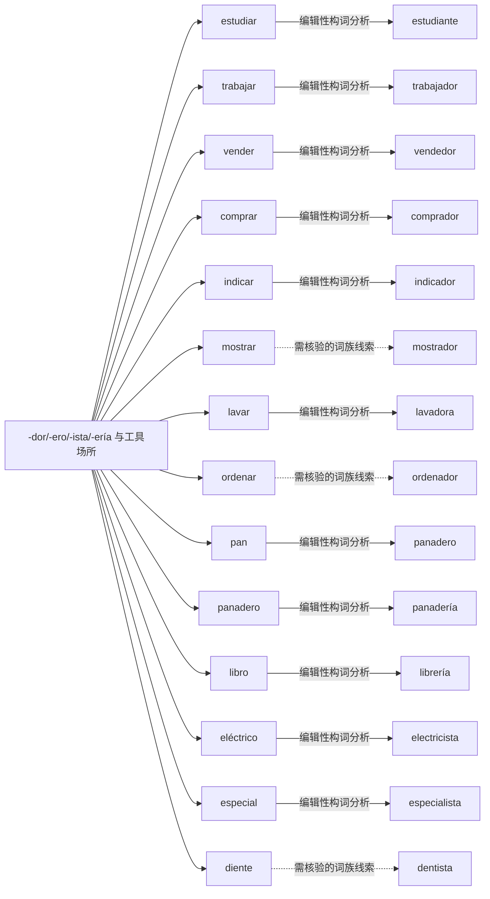

# -dor/-ero/-ista/-ería 与工具场所｜可编辑 Mermaid 词族图

> 这是**现代词形与词族学习关系图**，不是逐条获权威词源词典确认的历史关系图。实线表示相对透明的编辑性构词分析；虚线表示存在词干交替、历史关系或词汇化的词族线索。图中词与关系都可以直接在 Markdown 中修改。所有词必须在具体用法中核实。

## 逐词分解与核对提示（14 条）

| 词项 | 表层结构 / 词素线索 | 中文语义 | 分析备注 |
|---|---|---|---|
| **estudiante** | estudi · ante | 补充词族例词（主词库未收录） | 职业、身份、工具与场所后缀；学习者，来自 estudiar 词基。 |
| **trabajador** | trabaj · ador | 补充词族例词（主词库未收录） | 职业、身份、工具与场所后缀；劳动者、勤劳的。 |
| **vendedor** | vend · edor | 补充词族例词（主词库未收录） | 职业、身份、工具与场所后缀；销售者；-edor 是施事名词变体。 |
| **comprador** | compr · ador | 补充词族例词（主词库未收录） | 职业、身份、工具与场所后缀；买家。 |
| **indicador** | indic · ador | 指标 | 职业、身份、工具与场所后缀；指标、指示器。 |
| **mostrador** | mostr · ador | 柜台 | 职业、身份、工具与场所后缀；柜台，工具/处所义已词汇化。 |
| **lavadora** | lav · adora | 洗衣机 | 职业、身份、工具与场所后缀；洗衣机，工具义。 |
| **ordenador** | orden · ador | 电脑（西班牙常用） | 职业、身份、工具与场所后缀；西班牙常用‘电脑’，工具义已词汇化。 |
| **panadero** | pan · adero | 补充词族例词（主词库未收录） | 职业、身份、工具与场所后缀；面包师；-adero 在此为派生组合，不要推广至所有职业词。 |
| **panadería** | panader · ía | 面包店 | 职业、身份、工具与场所后缀；面包店，通过 panadero 的词干进一步名词化。 |
| **librería** | libr · ería | 补充词族例词（主词库未收录） | 职业、身份、工具与场所后缀；书店；词基元音脱落。 |
| **electricista** | electric · ista | 电工 | 职业、身份、工具与场所后缀；电工；词干形态变化。 |
| **especialista** | especial · ista | 专科医生 | 职业、身份、工具与场所后缀；专科人员/专家。 |
| **dentista** | dent · ista | 补充词族例词（主词库未收录） | 职业、身份、工具与场所后缀；牙医；词根与 diente 有交替，不是拼接 diente+ista。 |

[返回构词系统总目录](README-完整词根词缀系统.md) · [完整结构化校验数据](../data/morphology/curated_analyses.csv) · [逐条索引](../data/morphology/morphology_master.csv)
