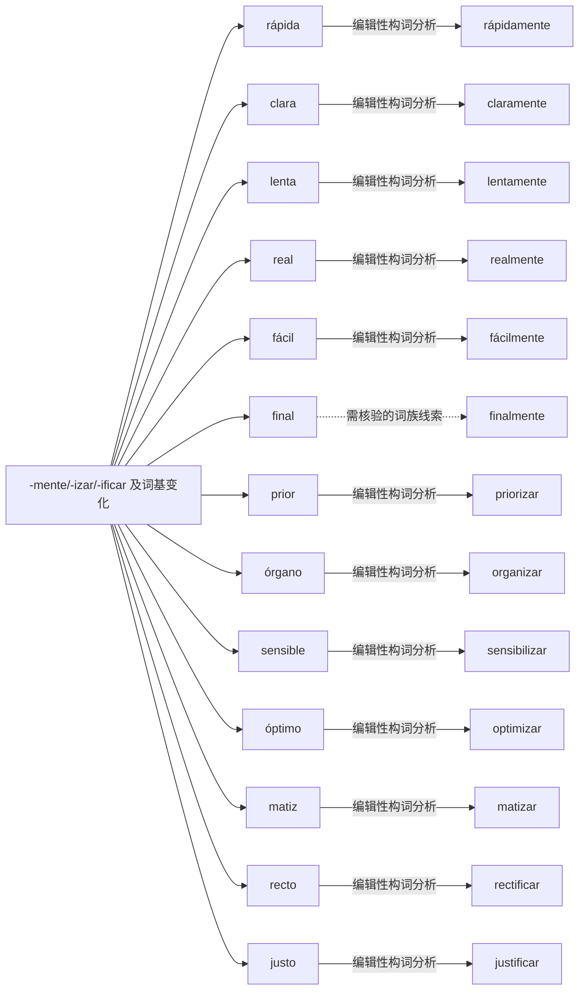

# -mente/-izar/-ificar 及词基变化｜可编辑 Mermaid 词族图

> 这是**现代词形与词族学习关系图**，不是逐条获权威词源词典确认的历史关系图。实线表示相对透明的编辑性构词分析；虚线表示存在词干交替、历史关系或词汇化的词族线索。图中词与关系都可以直接在 Markdown 中修改。所有词必须在具体用法中核实。

## 逐词分解与核对提示（13 条）

| 词项 | 表层结构 / 词素线索 | 中文语义 | 分析备注 |
|---|---|---|---|
| **rápidamente** | rápida · mente | 补充词族例词（主词库未收录） | 形容词、程度副词、动词形成及评价后缀；通常基于形容词阴性形式 rápida 加 -mente。 |
| **claramente** | clara · mente | 补充词族例词（主词库未收录） | 形容词、程度副词、动词形成及评价后缀；清楚地；基于形容词 clara。 |
| **lentamente** | lenta · mente | 补充词族例词（主词库未收录） | 形容词、程度副词、动词形成及评价后缀；慢慢地。 |
| **realmente** | real · mente | 补充词族例词（主词库未收录） | 形容词、程度副词、动词形成及评价后缀；实际上，形容词 real 男女同形。 |
| **fácilmente** | fácil · mente | 补充词族例词（主词库未收录） | 形容词、程度副词、动词形成及评价后缀；不变形容词 fácil 保留重音符号。 |
| **finalmente** | final · mente | 最终；最后 | 形容词、程度副词、动词形成及评价后缀；最终；不能把所有 -mente 理解为单纯方式副词。 |
| **priorizar** | prior · izar | 优先处理 | 形容词、程度副词、动词形成及评价后缀；使……优先，词基 prior。 |
| **organizar** | organ · izar | 安排；组织 | 形容词、程度副词、动词形成及评价后缀；词基 organ- 与 órgano 有形态和意义演变；并非原词直接拼接。 |
| **sensibilizar** | sensibil · izar | 补充词族例词（主词库未收录） | 形容词、程度副词、动词形成及评价后缀；由 sensible 词干相关；存在词干变化。 |
| **optimizar** | optim · izar | 优化 | 形容词、程度副词、动词形成及评价后缀；词基优化过程；形态与 óptimo 对应。 |
| **matizar** | mat · izar | 补充细微差别；修正措辞 | 形容词、程度副词、动词形成及评价后缀；来自 matiz 的词基改变，非 matiz + -izar 直接拼接。 |
| **rectificar** | rect · ificar | 补充词族例词（主词库未收录） | 形容词、程度副词、动词形成及评价后缀；词基 rect-；实际词义为纠正、改正。 |
| **justificar** | just · ificar | 说明理由；证明正当 | 形容词、程度副词、动词形成及评价后缀；说明理由、论证正当性。 |

[返回构词系统总目录](README-完整词根词缀系统.md) · [完整结构化校验数据](../data/morphology/curated_analyses.csv) · [逐条索引](../data/morphology/morphology_master.csv)
