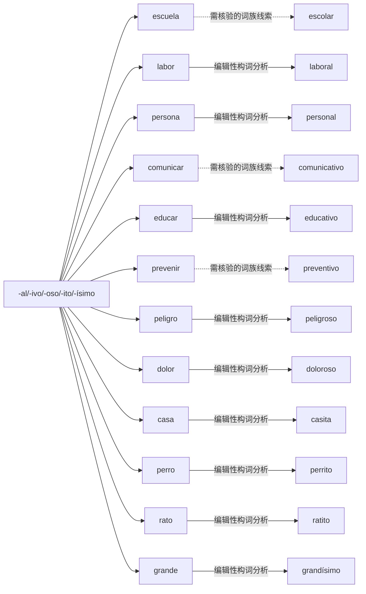

# -al/-ivo/-oso/-ito/-ísimo｜可编辑 Mermaid 词族图

> 这是**现代词形与词族学习关系图**，不是逐条获权威词源词典确认的历史关系图。实线表示相对透明的编辑性构词分析；虚线表示存在词干交替、历史关系或词汇化的词族线索。图中词与关系都可以直接在 Markdown 中修改。所有词必须在具体用法中核实。

## 逐词分解与核对提示（12 条）

| 词项 | 表层结构 / 词素线索 | 中文语义 | 分析备注 |
|---|---|---|---|
| **escolar** | escol · ar | 补充词族例词（主词库未收录） | 形容词、程度副词、动词形成及评价后缀；同词族但这里 **非透明的现代 escuela + 后缀**；更接近拉丁历史词干。 |
| **laboral** | labor · al | 补充词族例词（主词库未收录） | 形容词、程度副词、动词形成及评价后缀；与劳动/工作有关。 |
| **personal** | person · al | 补充词族例词（主词库未收录） | 形容词、程度副词、动词形成及评价后缀；个人/人事，词性由名词转形容词。 |
| **comunicativo** | comunic · ativo | 补充词族例词（主词库未收录） | 形容词、程度副词、动词形成及评价后缀；与交流有关；这里使用表面分段 -ativo，词源需审校。 |
| **educativo** | educ · ativo | 补充词族例词（主词库未收录） | 形容词、程度副词、动词形成及评价后缀；与教育有关；后缀 -ativo 为传统词形组成。 |
| **preventivo** | prevent · ivo | 补充词族例词（主词库未收录） | 形容词、程度副词、动词形成及评价后缀；拉丁词干 prevent- 与 prevenir 相关，不能简单截尾。 |
| **peligroso** | peligr · oso | 补充词族例词（主词库未收录） | 形容词、程度副词、动词形成及评价后缀；有危险的，从 peligro 关联。 |
| **doloroso** | dolor · oso | 补充词族例词（主词库未收录） | 形容词、程度副词、动词形成及评价后缀；疼痛的/令人痛苦的。 |
| **casita** | cas · ita | 补充词族例词（主词库未收录） | 形容词、程度副词、动词形成及评价后缀；小房子或亲昵称呼。 |
| **perrito** | perr · ito | 补充词族例词（主词库未收录） | 形容词、程度副词、动词形成及评价后缀；小狗/亲昵。 |
| **ratito** | rat · ito | 补充词族例词（主词库未收录） | 形容词、程度副词、动词形成及评价后缀；一小会儿的口语化。 |
| **grandísimo** | grand · ísimo | 补充词族例词（主词库未收录） | 形容词、程度副词、动词形成及评价后缀；程度很高，注意形容词形式变化。 |

[返回构词系统总目录](README-完整词根词缀系统.md) · [完整结构化校验数据](../data/morphology/curated_analyses.csv) · [逐条索引](../data/morphology/morphology_master.csv)
