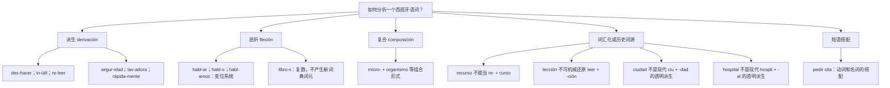

# 构词法分类与易误判范例｜Mermaid 可编辑

> 这张图是整个系统的**防错指南**。派生、屈折、词组搭配、历史词源不是同一种关系；表面出现 des、-ción、-ero 不足以证明存在现代可拆词素。

## 最容易犯的七类错误

1. **把词组当构词**：`pedir cita` 与 `estar en lista de espera` 是句法/词汇搭配，应分别分析词项，不能作为一个单词加词缀处理。
2. **把时态词尾当派生**：`habl-o / habl-amos` 反映动词变位；`hablar` 的 `-ar` 是不定式形态线索，而非名词化后缀。
3. **把词尾同形当同一来源**：`seguridad` 可与 `seguro` 联系，但 `ciudad` 不能据末尾 `-dad` 生造一个基础词。
4. **把前缀字母当成前缀**：`releer` 有透明的 `re-`，但 `receta` 和 `recurso` 不能按现代 `re-` 的重复义解释。
5. **忽视词干交替**：`decidir / decisión`、`leer / lección` 可以在词族中联系，不代表现代可以对所有动词套用同一后缀得到相应名词。
6. **把词源等同现代语义**：`ordenador` 的历史构造不能直接预测它在西班牙指“电脑”；`panadería` 是面包店，不等于任何 `-ería` 词都指商店。
7. **见到形态变化就断言准确**：`ir`、`ser` 等不规则动词应单独学习；例如 `tengo / tuve` 需按变位及异干现象处理。

## 核验来源与适用范围

- [RAE-ASALE Nueva gramática：规则动词的主题元音与屈折](https://www.rae.es/gram%C3%A1tica/morfolog%C3%ADa/la-conjugaci%C3%B3n-regular-i-caracter%C3%ADsticas-generales)
- [FundéuRAE：-mento 与 -miento 的区别](https://www.fundeu.es/consulta/mento-miento-sufijos-1570/)
- [INTEF 教学资料：morfología léxica 与 flexiva 的区分](https://descargas.intef.es/recursos_educativos/RED_ES/04_Bachillerato/1/B_1_064_2025_0923/morfologa_lxica.html)

所有 [135 条编辑性结构示例](../../data/morphology/curated_analyses.csv) 均仍保留进一步审校状态；图中“词族线索”不能直接解读为已独立证实的词源事实。