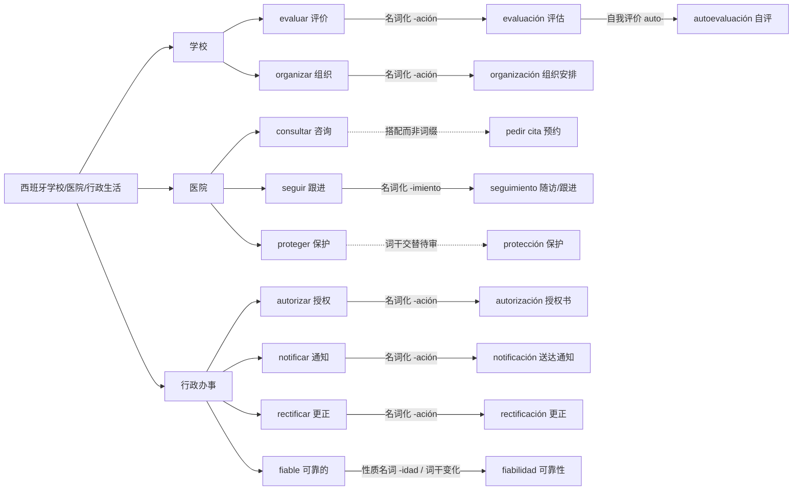

# 学校、医院与行政｜词缀在真实生活中的词族网络

> 本图专门把语言学习场景中的术语连到构词线索；同根/派生为实线，表层或历史联系待审用虚线，情境搭配用虚线标注“搭配”，不可混淆。

## 能迁移的真实句子

| 词族 | 西语常用表达 | 中文 |
|---|---|---|
| evaluar → evaluación | ¿Cuáles son los criterios de evaluación? | 评价标准有哪些？ |
| organizar → organización | La organización del centro ha cambiado. | 学校组织安排有变化。 |
| seguir → seguimiento | ¿Cómo se organiza el seguimiento después de la consulta? | 问诊后的随访怎么安排？ |
| autorizar → autorización | ¿Esta prueba requiere autorización previa? | 这项检查需要事先授权吗？ |
| notificar → notificación | No he recibido la notificación oficial. | 我还没有收到正式通知。 |
| rectificar → rectificación | Solicito una rectificación de los datos. | 我申请更正资料。 |

## 从场景迁移到词族练习

选一个词族，先看动词（动作），再找名词（过程、结果），最后用行政或医院真实角色说出一个请求句。注意：学校的 `evaluación`、医疗评估的 `valoración` 语境不同，不是完全可替换的同义词。