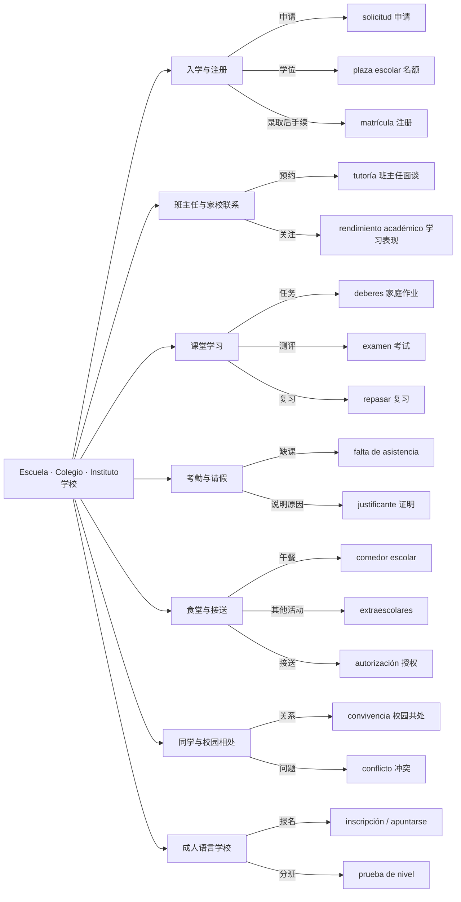

# 西班牙学校高频沟通｜场景总脑图

> 重点覆盖西班牙学校中的家校联系、课堂、就餐与接送，也含成人语言学校。**学习方法：先看关系 → 遮住脑图重画 → 用短句回答真实情境问题**。

## 规范说法与当地自然说法

| 中性/正式说法 | 西班牙口语常听到 | 注意场合 |
|---|---|---|
| `el colegio` | `el cole` | 家长朋友聊天自然；正式文件用 colegio |
| `el instituto` | `el insti` | 中学生口语；正式沟通用 instituto |
| `profesor / profesora` | `profe` | 校园口语，自然但非正式 |
| `matemáticas` | `mates` | 学生常用缩略 |
| `inscribirse` | `apuntarse` | 成人课程和活动，后者是常用自然口语 |
| `mucho trabajo` | `un montón de deberes` | 对作业量的夸张口语 |
| `qué bien` | `qué guay` | 同学/朋友间；正式家校沟通视关系决定 |

## 场景任务

1. 给秘书处询问下一学年的学位申请、材料与截止日期。
2. 给班主任请求 tutoría，并说明“我想知道孩子在课堂的进步情况”。
3. 向学校说明孩子发烧缺课，询问 justificante 要求。
4. 询问 deberes、examen、nota 及学校的学习要求。
5. 沟通 comedor / extraescolares / recogida，特别注意食物过敏时要明确说明。
6. 当孩子被同学持续伤害时，用 `me preocupa`、`acoso escolar`、`protocolo` 清晰沟通，而不把严重问题简单称作 `roce`。
7. 成人学习者询问 `prueba de nivel`、`inscripción`、`horario`。

## 真实办事与语言学习的区别

各自治大区、学校、教育阶段的申请和家校系统可能不同：**这是一张语言学习地图，不是 2026–2027 学年办事清单**。以学校公示和自治区教育行政部门公布为准。

### 资料参考
- [Comunidad de Madrid：学校入学申请](https://www.comunidad.madrid/educacion/solicita-tu-admision-educacion-infantil-obligatoria-bachillerato)
- [EducaMadrid：Raíces / ROBLE](https://site.educa.madrid.org/ies.sannicasio.leganes/index.php/plataforma-raices-roble/)

网站交互版见 [docs/index.html](../docs/index.html)；如 GitHub Pages 已启用，可在部署网站中选择“学校与教育”。
