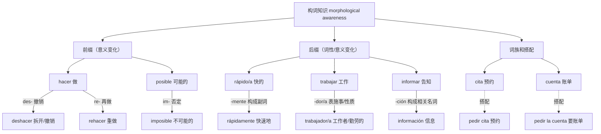

# A1–B2｜真实构词词族与常见词缀

> 实线表示示例性的构词关系；虚线表示搭配/概念关系而非必然的词源关系。词根词缀是一种**迁移和扩词工具**，不应代替词典释义与情境训练。

## 记忆验证

1. `hacer` 与 `deshacer` 的差别？分别说一句话。
2. 由 `posible` 回忆否定形式，并实际造句。
3. `trabajador/a` 可以是名词或形容词吗？举例验证。
4. `pedir cita` 为什么是搭配、不是派生词？因为没有构词操作，仅是词语组合。

## 禁止机械推断

- `-ción`、`-miento` 不是任意动词都能自由变换的“公式”。
- 同一前缀在不同时代的词可能形成不同语义，需核实用法。
- `información` 不只是“informar + ción”字面叠加，还需要具体语境。
