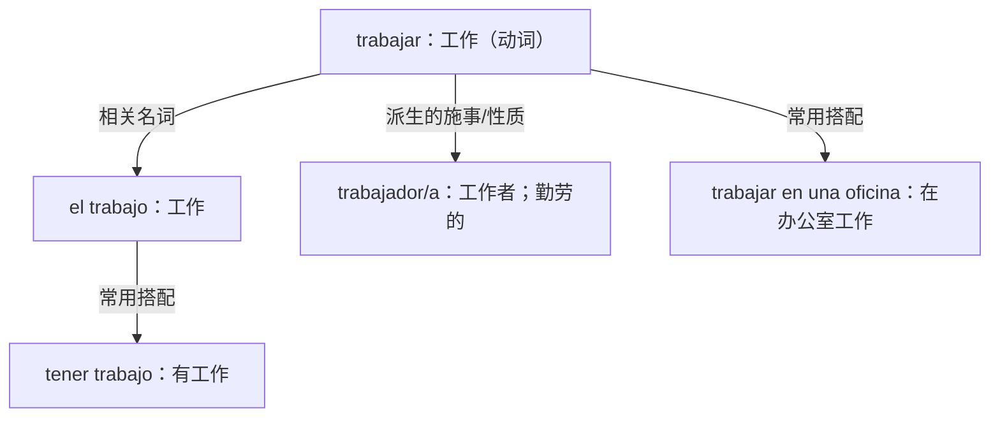

# 词根、前缀、后缀与词族｜准确构词，避免机械猜词

## 1. 不要把所有形式相似的词都当成一个词族

同一个词族要有可解释的构词关系，也要分别学习实际含义、词性、搭配。**词根词缀适合产生记忆线索，却不能代替语境。**

## 2. 常见、可核验的构词模式

| 模式 | 词汇关系（示例） | 主要理解 | 建议阶段 | 提醒 |
|---|---|---|---|---|
| `des-` | `hacer → deshacer` | 做 → 撤销/拆开 | A2–B1 | 不是所有带 des 的词都简单“取反” |
| `in-` | `correcto → incorrecto` | 正确 → 不正确 | B1 | 有音系形式变体，如 `imposible` |
| `im-` | `posible → imposible` | 可能 → 不可能 | B1 | 与 `in-` 有历史/音系关系，不是独立万能规则 |
| `re-` | `hacer → rehacer` | 做 → 重做 | A2–B1 | 不是任何词都可加 re- |
| `-dor/-dora` | `trabajar → trabajador/trabajadora` | 工作 → 工作者/工作的 | A2–B1 | 兼有名词、形容词用法 |
| `-ción` | `informar → información` | 告知 → 信息 | B1 | 动词到名词不总是规则拼接 |
| `-mente` | `rápida → rápidamente` | 快的 → 快速地 | B1 | 通常接形容词阴性单数形式；注意重音 |
| `-miento` | `conocer → conocimiento` | 认识 → 知识 | B1–B2 | 有词干变化，不能随意套用 |

## 3. 词族示范：trabajar

- `Trabajo en una cafetería.` 我在一家咖啡馆工作。
- `Tengo mucho trabajo hoy.` 我今天工作很多。
- `Mi hermana es muy trabajadora.` 我姐姐/妹妹很勤劳。

## 4. 词族示范：informar

- `informar (a alguien de/sobre algo)`：向某人通报某事
- `la información`：信息
- `informativo/a`：提供信息的、资讯性的
- `estar bien informado/a`：消息灵通、了解情况

这组词更适合 B1–B2，在掌握基本用法后再分析派生。

## 5. 学习策略

1. 先学 1 个高频核心词及 2 个真实例句。
2. 再加 1–3 个**真实存在且常用**的词族成员。
3. 每个成员建立一个情境与搭配。
4. 盖住图，尝试从核心词自己说出词族和句子。
5. 隔天换成不同场景进行迁移输出。
